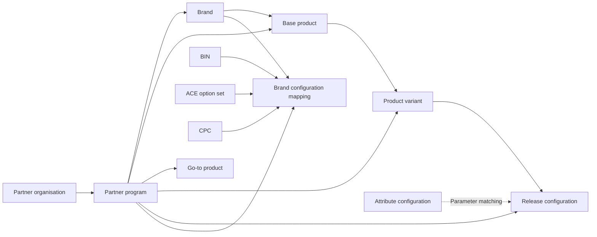

# Relay Workflow Studio

**Connected operations. Clear approvals. A complete history.**

Relay is an interactive UX concept for operations teams managing related entities across a maker, checker and auditor workflow. It combines guided creation, configurable approval routes, searchable relationships and contextual audit history in one workspace.

Built with browser-native HTML, CSS and JavaScript. No application dependencies or build step.

## Explore the concept

- **Sign in and choose authority.** An account can have one, several or no assigned authorities. The selected authority controls available workflows while the user's identity stays the same.
- **Act from My work.** Makers see drafts and returned requests; checkers see work ready for their decision; auditors inspect recent changes.
- **Create connected entities.** A guided form selects required parents, validates references, previews matching attributes and shows the approval route.
- **Review with context.** Compare active and proposed versions, inspect captured references, review stages and record a decision with a note.
- **Trace every relationship.** Search the entity directory, follow incoming and outgoing connections, or inspect the full connection table.
- **Inspect history and flow.** View per-record history, filtered audit exports, approval workload and lifecycle analytics.

## Run locally

Requirements: Python 3 to serve the app; Node.js 20 or later to run checks.

```sh
git clone https://github.com/Darshil-Papalkar/relay-workflow-studio.git
cd relay-workflow-studio
npm start
```

Open **http://127.0.0.1:4318**. No `npm install` is needed. You can also serve `dist/` using any static HTTP server.

### Demo access

All accounts use the fictional password **`Demo@123`**.

| Username | Assigned authorities |
| --- | --- |
| `aanya.shah` | Maker, Auditor |
| `nisha.rao` | Checker, Auditor |
| `dev.mehta` | Checker |
| `mira.kapoor` | Auditor |
| `restricted.user` | None; demonstrates the access-unavailable state |

A single authority is preselected but still requires Continue. With multiple authorities, choose one explicitly. Use the authority indicator in the header to change authority or sign out. The simulated session expires after eight hours; passwords are never persisted.

## Entity model



Each parent can support multiple children. Each child selects one parent for each required reference. Shared configurations can be reused across separately approved brand mappings. Go-to products remain an independent branch under a program. Every entity has its own approval and audit history.

## Approval and versioning rules

- Draft → In review → Approved, with Changes requested and Rejected outcomes.
- Per-entity policies support sequential or parallel review with one or two named sample reviewers.
- Sequential routes unlock reviewers in order. Parallel routes require all assigned reviewers and allow either to act first.
- Submission captures the route, approved reference versions and matched attributes. Later policy changes do not alter an in-flight review.
- Makers cannot approve their own work. Checker authority and reviewer assignment are both required for a decision.
- Auditor authority is read-only, including when that account also has Maker or Checker authority.
- A proposed amendment keeps the approved version available. Rejecting the amendment preserves that active version.
- Returned work can be edited and resubmitted; prior decisions reset for the new review attempt.
- Unfinished forms and review notes can be resumed. Saved drafts are separate business records.

Attribute rules match region, channel, segment or category using case-insensitive equality. Higher priority wins when writing the same attribute. Conflicting values at equal priority block submission. Captured attributes remain associated with the submitted version.

## Try a complete journey

1. Sign in as Aanya, choose Maker and create another brand under Core Services.
2. Submit it. Brand uses parallel review by default.
3. Sign in as Dev with Checker authority and approve; then sign in as Nisha with Checker authority and approve. Both decisions are required.
4. Return as Aanya with Maker authority and create a base product connected to the approved brand.
5. Find that brand in Relationship explorer and trace its parent and children.
6. Change to Auditor authority and inspect the same record's history. The identity remains Aanya while editing controls disappear.
7. Adjust an entity's approval policy to explore sequential review or a single-reviewer route on subsequent submissions.

## Project layout

| File | Purpose |
| --- | --- |
| `dist/index.html` | Application entry point |
| `dist/app.mjs` | Screens, guided forms, interactions and permission checks |
| `dist/auth.mjs` | Demo sign-in response and authority/session model |
| `dist/domain.mjs` | Entity model, validation, approvals, versions and audit events |
| `dist/explorer.mjs` | Search and relationship queries |
| `dist/operations.mjs` | Work queues, version comparisons and program families |
| `dist/styles.css` | Responsive layouts and Relay visual theme |
| `dist/assets/` | Original Relay vector identity |
| `workflow.test.mjs` | Domain, relationship and workflow checks |
| `auth.test.mjs` | Authentication response and authority checks |

## Verification

```sh
npm run check
npm test
```

The 32 automated checks cover repeated parent usage, shared configuration reuse, sequential and parallel approvals, policy capture, reference validation, amendments, matching conflicts, snapshots, history, relationship completeness, authority selection, identity preservation and session expiry.

## Prototype scope

This repository contains fictional sample data and browser-only behavior. Business records are stored in local storage and session selection in session storage. There is no backend or real identity provider. Use demo credentials only.

Before operational use, enforce authentication, authorization, ownership, segregation of duties, immutable audit history and concurrent updates on a backend. Replace the demo adapter with a service that returns the authenticated identity and assigned authorities. Server-side permissions must govern every mutation.

Policy administration is included with Maker for this concept. A production implementation should define a dedicated administration permission. The sample directory has two checkers; larger reviewer groups, quorums, delegation, escalation, effective dates, retirement and migration rules remain design extensions.

The interface uses original Relay artwork, system font fallbacks, an indigo and teal palette, keyboard focus states and responsive layouts. Approval of a release configuration represents approval of a record; it does not deploy an external system.
